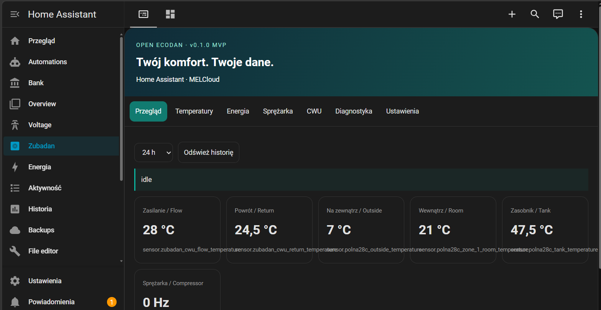

# Open Ecodan Dashboard

A lightweight Lovelace card for Mitsubishi Ecodan in Home Assistant.

<div align="center">
  
</div>

## Overview

This card reads existing Home Assistant entities and shows the most important Ecodan values in one dashboard: overview, temperatures, energy, compressor, DHW, diagnostics and settings.

It is meant for users who already have a working MELCloud integration in Home Assistant and want a cleaner operational view without adding a custom backend.

## Features

- overview of live values from Home Assistant
- temperature, energy and compressor views
- automatic entity detection for MELCloud devices
- manual mapping for ambiguous setups
- hourly COP and cost estimation from recorder statistics
- control actions for supported climate and water heater entities
- built for Home Assistant custom cards and HACS

## Requirements

- Home Assistant with MELCloud integration working
- recorder/history enabled
- Node.js 22+ for local build/test checks

## Install

1. Copy `dist/open-ecodan-dashboard.js` to `/config/www/open-ecodan-dashboard.js`
2. Add a new resource in Lovelace as a JavaScript module
3. Add the card with:

```yaml
type: custom:open-ecodan-dashboard
language: pl
controls: false
entities: {}
```

## HACS

This repo is set up for custom dashboard installation:

- keep `hacs.json` and `dist/` in the main branch
- add the repository as a custom HACS dashboard source
- install the card from there

## Development

```bash
npm run build
npm test
npm run check
```

## Notes

- this is not a new MELCloud integration
- it does not add a backend or external service
- it depends on HA entities and recorder data
- it is intended as an open-source dashboard layer, not a replacement for the MELCloud integration itself

For more details, see [docs/ARCHITECTURE.md](docs/ARCHITECTURE.md) and [README.en.md](README.en.md).
